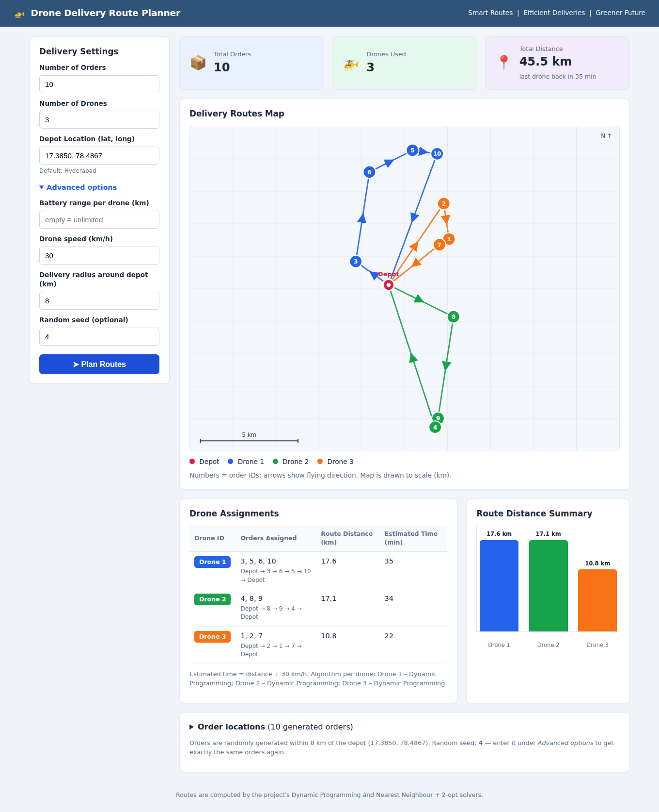
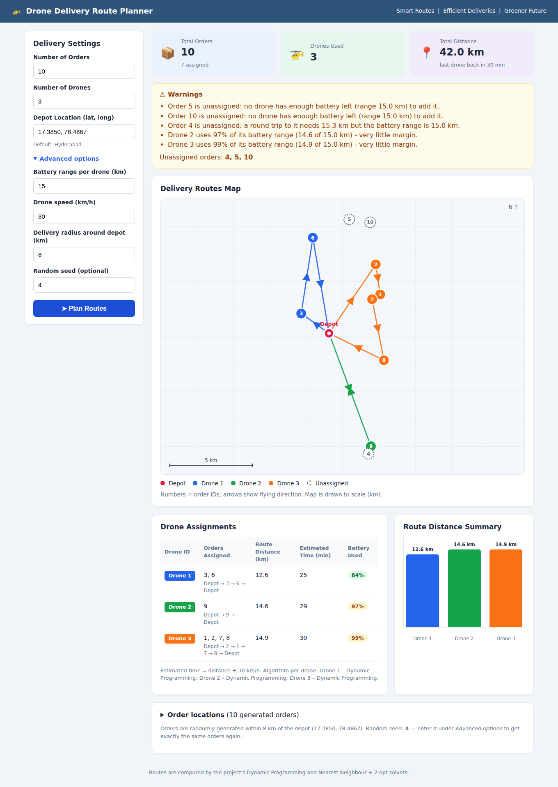
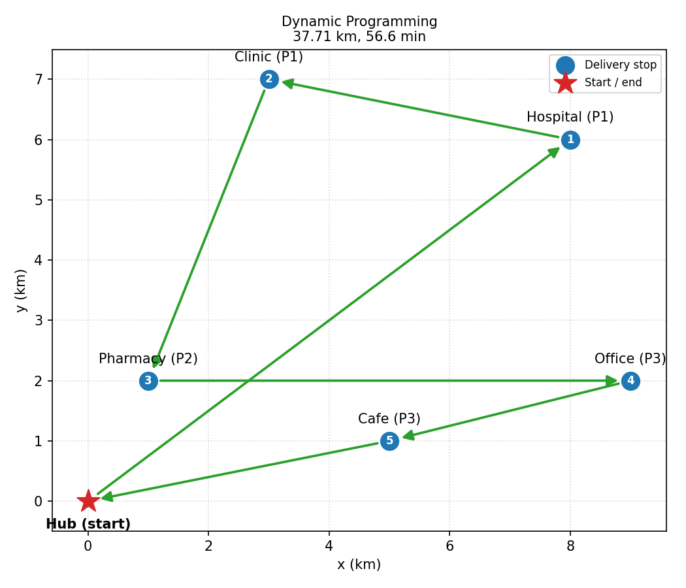

# Drone Delivery Route Planner

A beginner-friendly Python project that plans the shortest delivery routes for drones.
It has **two ways to use it**:

* a **website** (Flask) - choose the number of orders and drones, click **Plan Routes**, and see which
  drone delivers what, a colour-coded route map, distances, times and battery warnings;
* the original **command line** tool - plan one drone's round trip with Dynamic Programming,
  Branch and Bound or a fast heuristic, compare them, and plot the route.

Under the hood: the classic **Traveling Salesman Problem (TSP)** solvers, a multi-drone planner on top
of them, `multiprocessing`, and matplotlib / SVG route drawings.



## Quick start (website)

You need **Python 3.9+** and an internet connection for the first run only.

```bash
python start.py
```

That single command creates a private virtual environment (`.venv`), installs the packages, starts the
website and opens **http://127.0.0.1:5000** in your browser. Later runs start in seconds.
On Windows you can also **double-click `start.bat`**. Press `Ctrl+C` in the terminal to stop.

Prefer to do it step by step? **Windows PowerShell:**

```powershell
cd path\to\drone-delivery-route-planner
python -m venv .venv
.\.venv\Scripts\Activate.ps1          # if blocked: Set-ExecutionPolicy -Scope Process -ExecutionPolicy Bypass
pip install -r requirements.txt
python app.py
```
Then open **http://127.0.0.1:5000** in your browser (the terminal stays busy while the server runs; `Ctrl+C` stops it).

macOS / Linux: `python3 -m venv .venv && source .venv/bin/activate && pip install -r requirements.txt && python app.py`

### Using the website

| Field | Meaning |
|-------|---------|
| Number of Orders (1-60) | how many deliveries to plan (random addresses are generated around the depot) |
| Number of Drones (1-10) | size of the fleet; if there are fewer orders than drones the extra drones stay at the depot |
| Depot Location | `latitude, longitude` - default is Hyderabad |
| *Advanced:* Battery range | max km per drone trip (empty = unlimited). Orders a drone cannot reach are reported as unassigned |
| *Advanced:* Speed, radius, seed | drone speed (default 30 km/h), how far orders can be from the depot, and a seed to repeat the exact same orders |

**Results page:** total orders / drones used / total distance, a to-scale route map (colour per drone,
numbered orders, arrows), the drone assignment table with distance, time and battery use, a distance bar
chart, warnings, and the list of generated order coordinates.



### A 2-minute demo script
1. `python start.py` - the page opens. Click **Plan Routes** (10 orders, 3 drones).
2. Point out the map: each colour is one drone's round trip from the red depot; the table shows who delivers what.
3. Open **Advanced options**, enter *Battery range = 15* and plan again: orders that no drone can reach are
   dashed on the map and explained in the warnings.
4. Type a **seed** (e.g. `4`) to show the result is repeatable.
5. In a terminal: `python main.py --demo` (CLI) and `python main.py --benchmark` (algorithm comparison).

### How the multi-drone planning works
1. **Split** the orders between drones with the *sweep* method: sort by angle around the depot and cut the
   circle into groups of (almost) equal size, trying several cut positions and keeping the cheapest.
2. **Route** each group as its own TSP using this project's solvers: **Dynamic Programming** (optimal) for up to
   12 orders per drone, **Nearest Neighbour + 2-opt with random restarts** for bigger groups.
3. **Battery:** a route longer than the range loses its biggest-detour order; that order is offered to the other
   drones and reported as *unassigned* if nobody can reach it. Routes using more than 90% of the range raise a warning.

The split is a heuristic (the best split is not guaranteed), but each drone's route inside its group is
optimal when the group has up to 12 orders. Coordinates are latitude/longitude converted to a flat local map in
km around the depot (accurate for city-size areas). The map is an offline SVG sketch, not map tiles.

---

## What changed in the web upgrade

The command-line program is untouched (`python main.py ...` works exactly as before).

| File | Status | What / why |
|------|--------|------------|
| `app.py` | **new** | Flask server: `/` form page, `/plan` validates input, runs the planner, shows results; friendly error pages |
| `templates/base.html`, `_form.html`, `index.html`, `results.html` | **new** | the dashboard (sidebar form + results), blue-and-white like the reference design |
| `static/style.css` | **new** | styling, responsive down to phone width |
| `algorithms/fleet_planner.py` | **new** | multi-drone planning (sweep split + existing solvers + battery limits) |
| `utils/web_service.py` | **new** | form validation, random order generation, builds the data the page shows (no Flask inside, so it is testable) |
| `utils/route_svg.py` | **new** | draws the colour-coded route map as SVG (works offline) |
| `utils/geo.py` | **new** | latitude/longitude <-> km conversion, random points around the depot |
| `start.py`, `start.bat` | **new** | one-command setup and launch |
| `models/drone.py` | edited | optional `max_range_km` (battery range) and `can_fly()`; default `None` = unlimited, so old code is unaffected |
| `requirements.txt` | edited | added Flask |
| `tests/test_fleet_planner.py`, `tests/test_web_app.py` | **new** | 32 new tests (88 in total) |
| `README.md` | edited | this documentation |

> Your architecture PDF mentions `planner.py`, `battery.py` and `instance.py`. Those files do not exist in this
> project, so the equivalents are: planning = `algorithms/` (+ the new `fleet_planner.py`), battery = the range
> option in `models/drone.py` and the logic in `fleet_planner.py`, orders/instances = `utils/web_service.py`.

---

## 1. Problem statement

A drone must deliver packages to several locations on a 2D map (coordinates in km) and return to its
starting point. Find the order of visits that **minimises total distance** (and therefore flight
time at the drone's speed). Optionally, some deliveries are more urgent than others (priorities).

## 2. Objectives

* Model the problem with clean **object-oriented** classes.
* Solve it **exactly** for small inputs (Dynamic Programming, Branch and Bound).
* Solve it **approximately** for large inputs (Nearest Neighbour + 2-opt).
* Use **multiprocessing** to run algorithms side by side and to speed up large searches.
* **Compare** algorithms by distance and execution time and relate the results to their complexity.
* Visualise the route, handle invalid input, and test everything with `pytest`.

## 3. Technologies used

| Tool | Purpose |
|------|---------|
| Python 3.9+ | language (type hints, dataclasses) |
| `multiprocessing` | parallel algorithm runs / parallel restarts |
| `matplotlib` | 2D route visualisation |
| `pytest` | automated tests |
| `argparse`, `json` | command line options, JSON input |

## 4. Algorithm / procedure

1. **Input** - read locations, start point, drone speed and optional priorities (keyboard, JSON file, demo or random).
2. **Distance matrix** - compute the Euclidean distance between every pair of locations once.
3. **Solve** - run the algorithms (in parallel). Exact solvers are skipped when the input is too large.
4. **Choose** - the shortest tour wins (if tied, the faster algorithm).
5. **Report** - route, distance, estimated time (`distance / speed`), locations visited, algorithm, execution time.
6. **Compare and plot** - comparison table and matplotlib route with direction arrows.

### Dynamic Programming (Held-Karp) - exact
`dp[mask][last]` = shortest distance that starts at the depot, visits exactly the stops in `mask`, and ends at `last`.
Every sub-problem is solved once and reused, so we avoid trying all `n!` orders:

```
dp[{j}][j]        = dist(start, j)
dp[mask+k][k]     = min over last of dp[mask][last] + dist(last, k)
answer            = min over last of dp[all][last] + dist(last, start)
```
The route is rebuilt by following a `parent` table backwards.

### Branch and Bound - exact
Depth-first search builds the tour stop by stop (**branching**). For each partial tour a **lower bound**
on any completion is computed: distance already flown + for every remaining location its cheapest
allowed outgoing edge. If the bound is not better than the best complete tour found so far, the whole
branch is cut off (**bounding**). Pruning is helped by (a) a greedy starting upper bound and
(b) trying the nearest stop first. The program reports how many nodes were explored and pruned.

### Approximation - Nearest Neighbour + 2-opt
Nearest Neighbour flies to the closest unvisited stop each time. **2-opt** then repeatedly reverses a
section of the tour whenever that shortens it, until no swap helps. Optional **random restarts**
(parallelised by `RouteManager.solve_large_parallel`) keep the best of many local optima. Fast, but
not guaranteed optimal.

### Delivery priorities (optional)
Priority `1` is most urgent. A stop is only allowed once **all stops with a smaller priority number
have been visited**. DP and Branch and Bound enforce this with a bit mask (`DeliveryNetwork.required_masks`);
Nearest Neighbour only picks allowed stops and 2-opt rejects any swap that breaks the order, so *all*
algorithms return priority-valid routes. If every stop has priority 1 (the default) there are no rules.

## 5. System architecture

Web flow: **Browser form -> `app.py` (Flask) -> `utils/web_service.py` (validate, generate orders)
-> `algorithms/fleet_planner.py` (split between drones) -> solvers below -> results page + SVG map.**

```
                        main.py  (CLI, orchestration)
                           |
        +------------------+-------------------+
        |                  |                   |
 utils/input_handler   algorithms/RouteManager   utils/report + visualization
 (keyboard/JSON/demo)        |  (multiprocessing.Pool)   (text report, matplotlib)
        |        +-----------+-----------+-----------+
        v        v           v           v           v
  DeliveryNetwork   DynamicProgramming  BranchAndBound  Approximation
  (Location, Drone,  Solver              Solver          Solver
   distance matrix)        \             |             /
                            +---- TSPOptimizer (abstract base) ----+
                                         |
                                       Route  (result: path, distance, time, stats)
```

| Class | File | Responsibility |
|-------|------|----------------|
| `Location` | `models/location.py` | name, x, y, priority (validated) |
| `Drone` | `models/drone.py` | speed, distance -> time |
| `DeliveryNetwork` | `models/delivery_network.py` | start + stops + drone, distance matrix, priority rules |
| `Route` | `models/route.py` | a finished tour with totals and statistics |
| `TSPOptimizer` | `algorithms/base.py` | abstract solver: size check, timing, builds the `Route` |
| `DynamicProgrammingSolver` | `algorithms/dynamic_programming.py` | exact, Held-Karp |
| `BranchAndBoundSolver` | `algorithms/branch_and_bound.py` | exact, pruned search |
| `ApproximationSolver` | `algorithms/approximation.py` | Nearest Neighbour + 2-opt (+ restarts) |
| `RouteManager` | `algorithms/route_manager.py` | runs solvers in parallel, compares, parallel multi-start |
| `FleetPlanner` | `algorithms/fleet_planner.py` | several drones: sweep split, one TSP per drone, battery limits |

### Project structure

```
drone-delivery-route-planner/
├── start.py / start.bat         # one-command setup + launch of the website
├── app.py                       # Flask website
├── main.py                      # command line tool (single drone)
├── requirements.txt
├── pytest.ini
├── README.md
├── templates/                   # base, _form, index, results (HTML)
├── static/                      # style.css
├── data/                        # sample JSON inputs for the CLI
├── docs/                        # screenshots / figures used in this README
├── models/                      # location, drone, delivery_network, route
├── algorithms/                  # base, dynamic_programming, branch_and_bound,
│                                # approximation, route_manager, fleet_planner
├── utils/                       # distance, input_handler, report, visualization,
│                                # benchmark, exceptions, geo, route_svg, web_service
└── tests/                       # pytest test-suite (88 tests)
```

## 6. How to install (command line tool)

```bash
git clone https://github.com/<your-username>/drone-delivery-route-planner.git
cd drone-delivery-route-planner

python -m venv .venv
# Windows (PowerShell):  .venv\Scripts\Activate.ps1
# macOS / Linux:         source .venv/bin/activate

pip install -r requirements.txt     # also installs Flask for the website
```

## 7. How to run (command line tool)

```bash
python main.py                                   # interactive: type the locations in
python main.py --demo                            # the 5-location example
python main.py --file data/sample_input.json     # load from JSON
python main.py --file data/sample_input_priority.json   # with delivery priorities
python main.py --random 12 --seed 7              # random problem with 12 stops
python main.py --random 40 --seed 1              # large: exact solvers skipped, parallel multi-start used
python main.py --benchmark                       # scaling + multiprocessing benchmark
```

Options: `--speed KMH`, `--restarts N`, `--processes N`, `--sequential` (no multiprocessing),
`--no-plot` (skip the window), `--save route.png` (save the picture).
On Windows/macOS multiprocessing needs the `if __name__ == "__main__":` guard - `main.py` already has it.

### Running in VS Code
1. Install the **Python** extension; open the project folder (*File > Open Folder*).
2. `Ctrl+Shift+P` -> **Python: Select Interpreter** -> choose `.venv`.
3. Open a terminal (`Ctrl+``) and run `pip install -r requirements.txt`.
4. Website: open `app.py` and press **Run**, or type `python start.py` in the terminal. Command line tool: `python main.py --demo`.
5. Tests: `Ctrl+Shift+P` -> **Python: Configure Tests** -> *pytest* -> project root; run from the Testing sidebar (beaker icon).
6. To debug with arguments, add a launch configuration (*Run > Add Configuration > Python File*) with `"args": ["--demo"]`.

## 8. Sample input

Interactive mode (`name x y [priority]`; `B 2 3` and `B(2,3)` both work):

```
Number of delivery locations (not counting the start): 4
Start location [default: A 0 0]: A 0 0
Delivery location 1/4: B(2,3)
Delivery location 2/4: C 5 2
Delivery location 3/4: D 6 6
Delivery location 4/4: E 1 5
Drone speed in km/h [default: 30]: 30
```

JSON (`data/sample_input.json`):

```json
{
  "drone": { "name": "Drone-1", "speed_kmh": 30 },
  "start": { "name": "A", "x": 0, "y": 0 },
  "deliveries": [
    { "name": "B", "x": 2, "y": 3 }, { "name": "C", "x": 5, "y": 2 },
    { "name": "D", "x": 6, "y": 6 }, { "name": "E", "x": 1, "y": 5 }
  ]
}
```

Invalid input (non-numbers, duplicate names, priority < 1, speed <= 0, malformed JSON) is rejected
with a clear message; interactive mode simply asks again.

## 9. Sample output

`python main.py --demo`

```
========== DRONE DELIVERY ROUTE PLANNER ==========

Locations: 5  (1 start + 4 deliveries)
Drone: Drone-1 at 30 km/h

Best Route
  A -> C -> D -> E -> B -> A

Total Distance    : 20.45 km
Estimated Time    : 40.90 minutes
Locations Visited : 5
Algorithm         : Dynamic Programming
Execution Time    : 0.000 seconds

==================================================

Algorithm Comparison
Algorithm                                | Distance | Execution Time | vs Best
-----------------------------------------+----------+----------------+--------
Dynamic Programming                      | 20.45 km | 0.0001 s       | +0.00%
Branch and Bound                         | 20.45 km | 0.0001 s       | +0.00%
Approximation (Nearest Neighbor + 2-opt) | 20.45 km | 0.0001 s       | +0.00%
  Branch and Bound explored 11 nodes and pruned 15 branches.
```

> The brief's example shows "18.42 km" for this layout, but that number was only illustrative:
> for A(0,0), B(2,3), C(5,2), D(6,6), E(1,5) the true shortest round trip is
> 5.385 + 4.123 + 5.099 + 2.236 + 3.606 = **20.45 km** (all three algorithms agree, and the tests check
> it against brute force). The visiting order `A -> B -> C -> D -> E -> A` from the brief is 21.09 km.

With priorities (`--file data/sample_input_priority.json`; Hospital and Clinic = P1, Pharmacy = P2, Cafe and Office = P3):

```
Priorities: P1: Hospital, Clinic; P2: Pharmacy; P3: Cafe, Office

Best Route
  Hub -> Hospital -> Clinic -> Pharmacy -> Office -> Cafe -> Hub

Total Distance    : 37.71 km
Estimated Time    : 56.56 minutes
```



## 10. Complexity analysis

`n` = number of delivery stops (the depot is not counted).

| Method | Time | Space | Notes |
|--------|------|-------|-------|
| Distance matrix | O(n^2) | O(n^2) | computed once, shared by all solvers |
| **Dynamic Programming** (Held-Karp) | **O(n^2 * 2^n)** | **O(n * 2^n)** | `2^n * n` states, each tries `n` next stops. Far better than `O(n!)`, but memory grows fast - hence the default limit of 15 stops. |
| **Branch and Bound** | **O(n!)** worst case; usually far less | O(n^2) matrix + O(n) recursion | Pruning only helps in practice, not in the worst case. Each node here also costs about O(n^2) to bound. Quality of the bound decides the speed. |
| **Approximation** (Nearest Neighbour + 2-opt) | NN: O(n^2); 2-opt: O(n^2) per pass, usually only a few passes | O(n) extra | No optimality guarantee. `r` restarts cost `r` times as much. |
| **Multiprocessing** | ideal wall time ~ T/p + overhead for `p` processes and `T` total work | `p` copies of the problem: O(p * n^2) | Speed-up is limited by the number of CPU cores, the number of independent tasks, and process start-up and pickling cost. `compare()` takes about as long as the *slowest* solver instead of the sum. |

| **Fleet planning** (`n` orders, `k` drones) | sweep: O(c * k * g^2) for c <= 24 cut positions, then one TSP per drone with `g = n/k` orders (DP: O(g^2 * 2^g) for g <= 12) | O(g * 2^g) | A heuristic split; each route is optimal when g <= 12. The web page answers in well under a second for 60 orders. |

Priorities do not change these classes: they only remove some transitions (a cheap bit-mask test).

## 11. Results

Measured with `python main.py --benchmark` on random maps (one run each; absolute times depend on your machine,
the **trend** is what matters):

| Stops | DP (s) | B&B (s) | Approx (s) | Approx vs optimal |
|------:|-------:|--------:|-----------:|------------------:|
| 4 | 0.0000 | 0.0001 | 0.0000 | +0.00% |
| 6 | 0.0002 | 0.0005 | 0.0000 | +0.42% |
| 8 | 0.0009 | 0.0041 | 0.0000 | +0.00% |
| 10 | 0.0056 | 0.0187 | 0.0001 | +0.00% |
| 12 | 0.0359 | 0.0374 | 0.0001 | +0.00% |
| 14 | 0.1753 | 4.6578 | 0.0001 | +0.67% |
| 16, 20, 30 | skipped | skipped | 0.0001 - 0.0002 | n/a |

What this shows:

* **DP's time grows about 5-6x for every 2 extra stops** (the `2^n` term times an `n^2` factor). It is predictable and quick up to ~15 stops.
* **Branch and Bound is correct but its speed depends heavily on the map.** In this pure-Python version its simple
  bound makes it slower than DP at 14 stops (it explored about 290,000 nodes instead of the ~87 billion orderings,
  yet that still takes seconds). Its advantage is memory: O(n) instead of DP's O(n * 2^n). A stronger bound
  (e.g. a minimum spanning tree / 1-tree) would improve it a lot.
* **The approximation is orders of magnitude faster and within 0-1% of optimal** on these maps, and it is the only option for
  larger inputs. With 30 stops, 32 parallel restarts improved the plain 2-opt tour by 2.7%.
* **Multiprocessing:** all runs through `multiprocessing` return exactly the same tours as sequential runs (tested).
  The benchmark below was recorded on a **single-core** sandbox, so it shows *no* speed-up, as expected. On a machine
  with several cores the restarts are shared between processes, so run `python main.py --benchmark` on your own
  computer to see the speed-up (200 stops, 200 restarts: one process 3.4 s here).

```
200 stops, 200 restarts, 1 CPU process(es)
  one process : 3.435 s
  in parallel : 3.116 s   (speed-up x1.10)     <- 1 core only; expect more with more cores
  same best tour found: True
```

## 12. Testing

```bash
pytest            # run everything
pytest -v         # one line per test
pytest tests/test_dp.py            # one file
pytest -k priorities               # tests whose name contains "priorities"
```

| File | Covers |
|------|--------|
| `test_distance.py` | Euclidean distance, matrix, `Location`/`Drone` validation, time calculation |
| `test_network_and_route.py` | network validation, priority masks, route generation and invalid tours |
| `test_dp.py` | DP vs brute force, known shapes, priorities, size limits |
| `test_branch_bound.py` | B&B vs brute force and DP, pruning, priorities |
| `test_approximation.py` | valid tours, 2-opt never worsens, reproducible restarts, priorities |
| `test_input_handler.py` | parsing, re-prompting, JSON loading, error cases |
| `test_route_manager.py` | parallel vs sequential equality, skipping large problems, parallel multi-start |
| `test_fleet_planner.py` | every order delivered once, even split, battery limits, unassigned orders, validation |
| `test_web_app.py` | pages and forms (Flask test client), input validation, order generation, lat/long maths, SVG map |

## 13. Step-by-step: how the project was built

1. **Foundations** - `utils/distance.py` (Euclidean distance + matrix) and `utils/exceptions.py`.
2. **Models** - `Location`, `Drone` (validated, immutable), `DeliveryNetwork` (distance matrix, priority masks), `Route`.
3. **Base class** - `TSPOptimizer` with a template method `solve()` so each algorithm only writes `_find_order()`.
4. **Heuristic first** - Nearest Neighbour + 2-opt: simplest, also gives Branch and Bound its starting upper bound.
5. **Dynamic Programming** - bit-mask Held-Karp with a parent table.
6. **Branch and Bound** - depth-first search, lower bound, pruning counters.
7. **RouteManager** - `multiprocessing.Pool`, per-algorithm timing, sequential fallback, parallel multi-start.
8. **I/O** - `input_handler` (validation), `report`, `visualization`, `benchmark`.
9. **main.py** - argparse CLI tying it together.
10. **Tests** - each exact solver is checked against brute force on random small maps.

## 14. Future enhancements

* Multiple charging or return trips per drone, and package weights / drone capacity.
* Better order-to-drone splitting (e.g. k-means or an exact Vehicle Routing solver).
* A real tiled map (Leaflet / Folium) - the planner already works with latitude/longitude.
* Let users type or upload their own order addresses instead of generating random ones.
* **Time windows** per delivery and **no-fly zones** / obstacles (non-straight paths).
* Real **GPS coordinates** with haversine distance and wind-aware travel times.
* Stronger Branch and Bound bounds (1-tree), **Or-opt / Lin-Kernighan**, or a **genetic algorithm**.
* Cache and compile hot loops (NumPy / Numba) for larger exact solves.

## 15. Upload to GitHub

```bash
cd drone-delivery-route-planner
git init
git add .
git commit -m "Initial commit: Drone Delivery Route Planner"
git branch -M main

# Create an EMPTY repo named drone-delivery-route-planner on github.com first (no README/.gitignore), then:
git remote add origin https://github.com/<your-username>/drone-delivery-route-planner.git
git push -u origin main
```

Later changes: `git add .` -> `git commit -m "Describe the change"` -> `git push`.
(If GitHub asks for a password, use a Personal Access Token, or sign in with GitHub CLI: `gh auth login`.)
